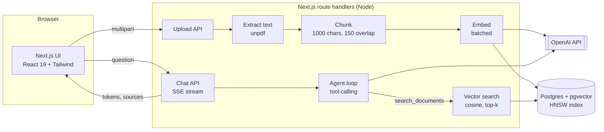

<div align="center">

# DocMind

**Chat with your documents and get answers you can check.**

Upload PDFs and notes, ask questions in plain English, and get streamed answers with page-level citations.

[](https://github.com/Amitgoswami12/docmind/actions/workflows/ci.yml)


**[Live demo →](#)** (no sign-up: click *Try the live demo*)

<!-- Add a 60-second GIF here:  -->

</div>

## Features

- **Retrieval-augmented generation (RAG).** Documents are split into overlapping chunks, embedded with `text-embedding-3-small`, and stored in **PostgreSQL + pgvector** with an HNSW index for fast cosine search.
- **Cited answers.** Every claim carries a `[n]` marker. Click it to see the exact passage, document and page.
- **Agent with tool calling.** The model chooses between `search_documents`, `list_documents` and `summarize_document`, and can search several times with different wording before answering (up to 5 steps).
- **Real-time streaming.** Tokens and status updates ("Searching your documents…") stream to the browser over **Server-Sent Events**, and the user can stop a response mid-stream.
- **Workspaces.** Separate projects, each with its own documents, chat history and vector search scope.
- **One-click demo.** Visitors get a private guest account preloaded with a sample handbook. Embeddings are copied in SQL, so starting a demo costs no API calls.
- **Production basics.** JWT sessions in httpOnly cookies, bcrypt password hashing, Zod validation, per-user daily rate limits, upload size and type checks, and tracking of token usage and latency per answer.
- **Measured quality.** An evaluation script scores retrieval hit rate, answer accuracy, citation rate, refusals on unanswerable questions, and latency.

## Architecture



**How a question is answered**

1. The user's question and recent chat history go to the agent loop.
2. The model calls `search_documents`. The query is embedded and matched against chunks in the active workspace by cosine similarity.
3. Retrieved passages are numbered `[1]…[n]` and returned to the model as tool output.
4. The model may search again, then streams a final answer that cites passage numbers.
5. Only the cited sources are saved with the message, along with token usage and latency.

## Evaluation

Run against 28 questions about the sample handbook, 3 of which can't be answered from it:

```bash
npm run eval
```

| Metric | Result |
|---|---|
| Retrieval hit@6 | _run `npm run eval`_ |
| Answer accuracy | _…_ |
| Citation rate | _…_ |
| Refuses unanswerable questions | _…_ |
| Average / p95 latency | _…_ |

Results are saved to `evals/results/latest.json`.

## Tech stack

| Layer | Tools |
|---|---|
| Frontend | Next.js 15 (App Router), React 19, TypeScript, Tailwind CSS 4, react-markdown |
| Backend | Next.js route handlers, Server-Sent Events, Zod |
| AI | OpenAI Chat Completions (streaming + tool calling), `text-embedding-3-small` |
| Data | PostgreSQL, pgvector (HNSW), Drizzle ORM |
| Auth | JWT (jose) in httpOnly cookies, bcrypt |
| Quality | Vitest unit tests, evaluation script, ESLint, GitHub Actions CI |
| Ops | Docker (standalone Next.js image), Docker Compose with pgvector |

## Run it locally

**Prerequisites:** Node.js 20+, an [OpenAI API key](https://platform.openai.com/api-keys), and Postgres with pgvector. A free [Neon](https://neon.tech) database works, or use `docker compose up -d db`.

```bash
git clone https://github.com/Amitgoswami12/docmind.git
cd docmind
npm install
cp .env.example .env.local      # then fill in DATABASE_URL, OPENAI_API_KEY, JWT_SECRET
npm run db:setup                # enables pgvector and creates tables
npm run db:seed                 # indexes the sample handbook for the demo
npm run dev                     # http://localhost:3000
```

| Script | What it does |
|---|---|
| `npm run dev` | Start the dev server |
| `npm test` | Unit tests (chunking, citations, SSE parsing) |
| `npm run typecheck` / `npm run lint` | Static checks |
| `npm run db:setup` | Enable pgvector + push the schema |
| `npm run db:seed` | Index `sample-docs/` for the demo account |
| `npm run eval` | Score answer quality on `evals/questions.json` |
| `npm run db:studio` | Browse the database |

## Project structure

```
src/
├── app/
│   ├── api/                 REST + SSE route handlers
│   ├── workspace/           Main app page
│   └── page.tsx             Landing page
├── components/workspace/    Chat UI, citation chips, documents panel
└── lib/
    ├── ai/                  OpenAI client, agent loop, tools, prompts
    ├── rag/                 parse → chunk → embed → retrieve, ingestion pipeline
    ├── db/                  Drizzle schema (users, workspaces, documents, chunks, chats, messages)
    ├── auth.ts              Sessions and password hashing
    └── sse.ts               Event encoding and incremental parser
scripts/                     db setup, demo seeding, evaluation
evals/questions.json         Evaluation set
tests/                       Vitest unit tests
```

## Deploy

1. Create a Neon database and run `npm run db:setup` and `npm run db:seed` against it.
2. Import the repo into [Vercel](https://vercel.com) and set `DATABASE_URL`, `OPENAI_API_KEY` and `JWT_SECRET`.
3. Deploy. Or build the Docker image: `docker build -t docmind .`

## Roadmap

- OCR for scanned PDFs
- Hybrid search (BM25 + vectors) with re-ranking
- Background ingestion queue for large files
- Shareable read-only chats
- Stripe billing for a Pro plan

## Author

**Amit Goswami** · [Portfolio](https://amitgoswami12.github.io) · [GitHub](https://github.com/Amitgoswami12)
